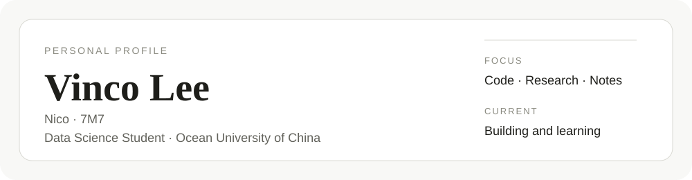

  <picture>
    <source media="(prefers-color-scheme: dark)" srcset="./profile-dark.svg">
    <source media="(prefers-color-scheme: light)" srcset="./profile-light.svg">
    
  </picture>

  <strong>Vinco Lee</strong> 
  Nico · 7M7 
  Data Science student at Ocean University of China

  <a href="https://vincolee.github.io/">Blog</a> ·
  <a href="mailto:liwanlin0525@gmail.com">Email</a>

---

### About

I'm studying data science and building things along the way — from machine learning experiments to small software projects.  
I use this space to keep my code, notes, and work in one place.

### Selected work

- **[Voice Lock](https://github.com/vincolee/voice-lock-mfcc-vq)** — An offline voice and passphrase verification app built with Python and PySide6.
- **[SkillProof](https://github.com/SkillProof-Team/SkillProof)** — A team project for job-oriented skill assessment, built with React and FastAPI.
- **[Mobile Development](https://github.com/vincolee/Mobile-Development2026)** — WeChat mini-programs, HarmonyOS experiments, and coursework.

### Tools

`Python` · `TypeScript` · `Java` · `SQL` · `Git`
