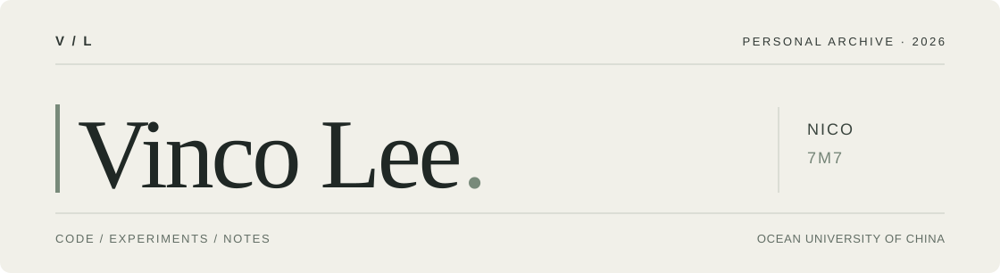

  

  <b>Nico</b> · Data Science &amp; Big Data Technology · Ocean University of China 
  <a href="https://vincolee.github.io/">Blog</a> &nbsp;·&nbsp; <a href="mailto:liwanlin0525@gmail.com">Contact</a>

---

I'm Nico, a data science student at Ocean University of China. I build software, experiment with machine learning, and keep notes on what I learn along the way.

### Selected work

**[Voice Lock](https://github.com/vincolee/voice-lock-mfcc-vq)**  
An offline voice and passphrase verification application built with Python and PySide6.

**[SkillProof](https://github.com/SkillProof-Team/SkillProof)**  
A team-built platform for skill assessment, using React and FastAPI.

**[Mobile Development](https://github.com/vincolee/Mobile-Development2026)**  
Course projects and experiments with WeChat Mini Programs and HarmonyOS.

Python · TypeScript · Java · SQL · Git
